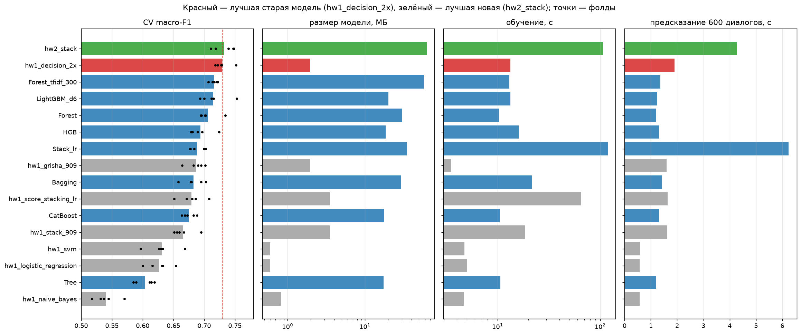
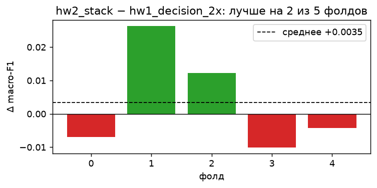
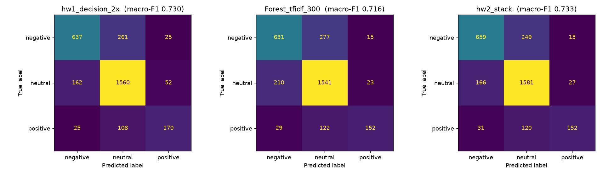
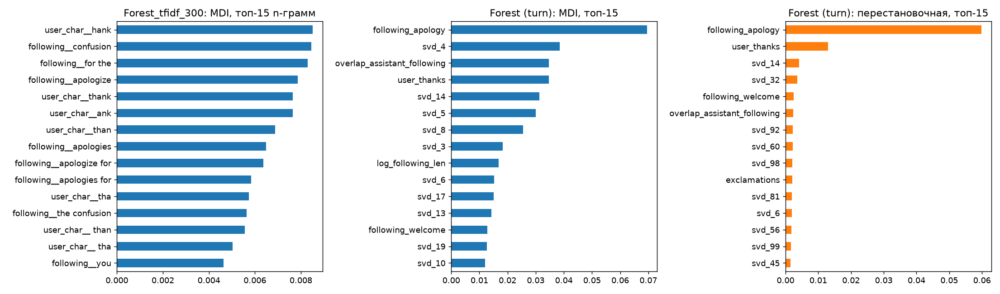
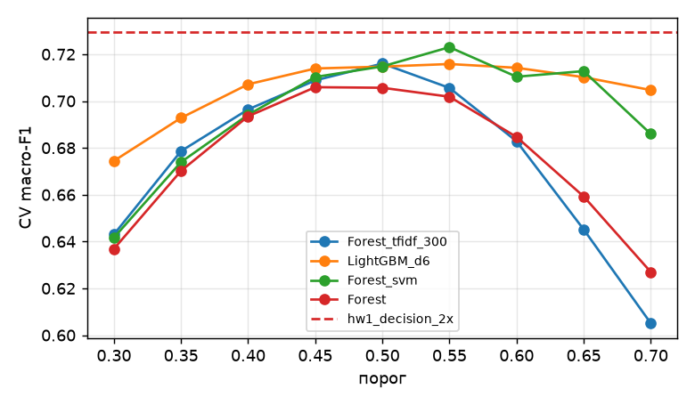
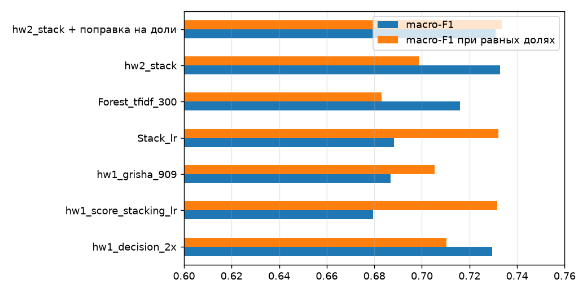
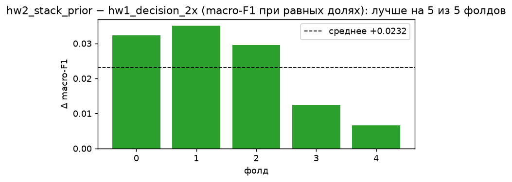

# HW2. Деревья и ансамбли: реакция пользователя

| файл | что делает |
|:--|:--|
| `solution.ipynb` | грузит все модели `hw1_*` и `hw2_*` из `artifacts/`, пишет `predictions.csv`; читает `HW2_TRAIN`, `HW2_DATA`, `HW2_LABELS`, `HW2_PREDICTIONS` |
| `experiments.ipynb` | все эксперименты, таблицы и графики (результаты CV берутся из кэша `artifacts/cv/`) |
| `experiments.py` | список всех моделей; `python experiments.py` пересчитывает CV всех моделей |
| `train_final.py` | обучает финальные `hw2_*` на всех 3000 диалогах |
| `splits.py`, `cv.py` | данные, группы, фолды; общий цикл CV |
| `old_models.py` | переобучение моделей HW1 с их гиперпараметрами |
| `trees.py`, `turn_stack.py` | признаки реплик, деревья, стекинг |
| `report.py`, `build_notebook.py` | графики; сборка `experiments.ipynb` |

Данные: `data/hw1_train.jsonl`. Окружение: Python 3.14, scikit-learn 1.9.1, lightgbm 4.7.0, catboost 1.2.10.
`solution.ipynb` на скрытом тесте (990 диалогов, 12 моделей, CPU) работает 41 с.

## Валидация

Все модели оцениваются на одних 5 фолдах:
`StratifiedGroupKFold(5, shuffle=True, random_state=42)`
(TF-IDF реплик пользователя, косинус ≥ 0.95, 2987 групп) на всех 3000 размеченных диалогах.
Числа CV из отчёта HW1 напрямую не сравниваются (другой сплит), поэтому все модели HW1
переобучены на этих фолдах с гиперпараметрами HW1. Скрытый тест для выбора моделей не
использовался, на нём только проверялся запуск `solution.ipynb` (без меток)

Разброс macro-F1 между фолдами ±0.01-0.02, поэтому модели сравниваются попарно по фолдам

## Модели

**Старые (`hw1_*`, без изменений):** NB, LR, SVM на TF-IDF текста диалога;
Decision_2x - два LinearSVC по репликам + правило последней реакции;  
Score_LR -LR на 12 признаках диалога из оценок Decision_2x;  
909 - те же модели на подвыборке 1:1:1

**Новые (`hw2_*`):** объект - реплика пользователя j ≥ 1. Признаки: - TF-IDF 42k
(слова и символы реплики, ответ ассистента до и после), `turn` - SVD(100) от `raw` +
37 числовых. Модель даёт вероятности для реплик, метка диалога - последняя реплика с
max(P(neg), P(pos)) ≥ порога, иначе neutral

| модель | ? |
|:--|:--|
| `hw2_random_forest` | RandomForest, 300 деревьев, leaf 3, на `raw`, веса классов balanced |
| `hw2_hgb` | HistGradientBoosting, depth 4, lr 0.07, 200 итераций, на `turn` |
| `hw2_lightgbm` | LightGBM, depth 6, lr 0.07, 200 итераций, на `turn` |
| `hw2_stack` | стекинг на OOF по репликам: базы - SVM из `hw1_decision_2x`, Forest_tfidf_300, LightGBM_d6; мета -LR; OOF из 3 внутренних фолдов; порог подбирается на OOF обучающей части |
| `hw2_stack_prior` | `hw2_stack` с поправкой вероятностей на доли классов (см. гипотезу) |

## Общая таблица

5 фолдов, среднее ± std. «При равных долях» - macro-F1 с весами классов `balanced`.
Время и размер - на фолде 0: обучение на 2400 диалогах с нуля, предсказание 600 диалогов,
pickle обученной модели. Полная таблица всех 31 модели - `artifacts/summary_table.csv`.

| модель | семейство | CV macro-F1 | при равных долях | accuracy | recall pos | обучение, с | предсказание, с | размер, МБ |
|:--|:--|--:|--:|--:|--:|--:|--:|--:|
| **hw2_stack** | стекинг | **0.7330 ± 0.015** | 0.6987 | 0.797 | 0.50 | 107 | 4.3 | 63 |
| hw2_stack_prior | стекинг | 0.7311 | **0.7335** | - | - | 107 | 4.3 | 63 |
| **hw1_decision_2x** | HW1 | 0.7295 ± 0.012 | 0.7103 | 0.789 | 0.56 | 13 | 1.9 | 1.9 |
| Forest_tfidf_300 | лес | 0.7160 ± 0.006 | 0.6831 | 0.775 | 0.50 | 13 | 1.4 | 58 |
| LightGBM_d6 | бустинг | 0.7147 ± 0.021 | 0.6905 | 0.774 | 0.50 | 13 | 1.2 | 20 |
| Forest | лес | 0.7057 ± 0.015 | 0.6704 | 0.774 | 0.45 | 10 | 1.2 | 30 |
| HGB | бустинг | 0.6940 ± 0.016 | 0.6902 | 0.749 | 0.52 | 16 | 1.3 | 19 |
| Stack_lr (стек коллег) | стекинг | 0.6882 ± 0.011 | 0.7321 | - | 0.71 | 119 | 6.2 | 35 |
| hw1_grisha_909 | HW1 | 0.6867 ± 0.013 | 0.7054 | 0.735 | 0.60 | 3.5 | 1.6 | 2.0 |
| Bagging | бэггинг | 0.6828 ± 0.016 | 0.6659 | 0.750 | 0.47 | 22 | 1.4 | 29 |
| hw1_score_stacking_lr | HW1 | 0.6794 ± 0.019 | 0.7318 | 0.732 | 0.73 | 66 | 1.6 | 3.5 |
| CatBoost | бустинг | 0.6752 ± 0.009 | 0.7101 | 0.723 | 0.64 | 10 | 1.3 | 18 |
| hw1_stack_909 | HW1 | 0.6658 ± 0.016 | 0.7168 | 0.718 | 0.71 | 18 | 1.6 | 3.6 |
| hw1_svm | HW1 | 0.6309 ± 0.023 | 0.5910 | 0.726 | 0.36 | 4.8 | 0.6 | 0.6 |
| hw1_logistic_regression | HW1 | 0.6269 ± 0.018 | 0.6063 | 0.715 | 0.41 | 5.1 | 0.6 | 0.6 |
| Tree | дерево | 0.6039 ± 0.014 | 0.6564 | 0.660 | 0.62 | 11 | 1.2 | 17 |
| hw1_naive_bayes | HW1 | 0.5402 ± 0.018 | 0.5619 | 0.615 | 0.44 | 4.7 | 0.6 | 0.8 |

Лучшая новая модель против лучшей старой по фолдам: `hw2_stack` − `hw1_decision_2x` =
−0.007, +0.026, +0.012, −0.010, −0.004 (среднее +0.0035, лучше на 2 из 5).

## Матрицы ошибок

Ошибки из матриц ошибок, число диалогов из 3000. Запись «neg → neu» - клетка матрицы
«истина negative, предсказано neutral».

| модель | пропущена реакция (neg → neu + pos → neu) | ложная реакция (neu → neg + neu → pos) | перепутана полярность (neg → pos + pos → neg) | всего ошибок (сумма вне диагонали = 3000 - диагональ) |
|:--|--:|--:|--:|--:|
| hw1_decision_2x | 369 (261 + 108) | 214 (162 + 52) | 50 (25 + 25) | 633 (3000 - 2367) |
| Forest_tfidf_300 | 399 (277 + 122) | 233 (210 + 23) | 44 (15 + 29) | 676 (3000 - 2324) |
| LightGBM_d6 | 319 (209 + 110) | 303 (264 + 39) | 56 (13 + 43) | 678 (3000 - 2322) |
| hw2_stack | 369 (249 + 120) | 193 (166 + 27) | 46 (15 + 31) | 608 (3000 - 2392) |

Главная ошибка - пропущенная реакция (negative ->  neutral: 261 диалог у Decision_2x).
Decision_2x и Forest_tfidf_300 расходятся на 407 диалогах (13.6%): прав Decision_2x в 210,
лес - в 167. Модель типа «правильная из двух» дала бы 0.799 - отсюда идея стекинга по репликам

## Важность признаков

Фолд 0: модели обучены на 2400 диалогах, перестановочная важность - на репликах валидации,
macro-F1, 5 перестановок.

- Лес на TF-IDF опирается на благодарность пользователя (`thank`, `hank`, `ank`) и на
  извинения ассистента в следующем ответе (`apologize`, `apologies`, `confusion`).
  Модель смотрит на реакцию ассистента, а не только на текст пользователя: если
  ассистент извиняется, пользователь, скорее всего, был недоволен.
- MDI и перестановочная важность сходятся в главном: `following_apology` (1-е место
  в обеих) и `user_thanks` (4-е и 2-е). Расхождения ожидаемые. MDI завышает непрерывные
  признаки с большим числом порогов (`overlap_assistant_following` - 3-е место по MDI,
  6-е по перестановочной; `svd_4` - 2-е по MDI, вне топ-15 по перестановочной).
  Перестановочная важность у многих SVD-компонент около 0.002: они взаимозаменяемы, и
  перестановка одной не мешает лесу.
- Мета-LR `hw2_stack`: для negative главный вес у SVM-оценки negative (0.61), для
  positive - у SVM-оценки positive (0.50) и P(pos) леса (0.30). 

## Подбор

| шаг | изменение | CV macro-F1 | Δ к родителю | лучше по фолдам |
|:--|:--|--:|--:|:--|
| Forest → Forest_tfidf | TF-IDF вместо SVD-признаков | 0.7117 | +0.006 | 4/5 |
| Forest_tfidf → leaf 1 | min_samples_leaf 3 → 1 | 0.7051 | −0.007 | 2/5 ✗ |
| Forest_tfidf → leaf 6 | min_samples_leaf 3 → 6 | 0.7051 | −0.007 | 1/5 ✗ |
| Forest_tfidf → max_features 0.02 | sqrt → 0.02 | 0.7076 | −0.004 | 2/5 ✗ |
| **Forest_tfidf → 300 деревьев** | 100 → 300 | **0.7160** | +0.004 | 4/5 |
| Forest_tfidf → без весов классов | balanced → нет | 0.6399 | −0.072 | 0/5 ✗ |
| LightGBM → depth 3 | 4 → 3 | 0.6706 | −0.017 | 0/5 ✗ |
| **LightGBM → depth 6** | 4 → 6 | **0.7147** | +0.027 | 5/5 |
| LightGBM → lr 0.03, 600 итераций | | 0.6831 | −0.005 | 2/5 ✗ |
| LightGBM → TF-IDF | вместо SVD | 0.7117 | +0.024 | 5/5 |
| LightGBM + оценки SVM | OOF-оценки Decision_2x как признак | 0.6799 | −0.008 | 1/5 ✗ |
| Forest + оценки SVM | то же для леса | 0.7148 | +0.009 | 4/5 |
| лес на TF-IDF всего диалога | без разбиения на реплики (заведомо неудачная) | 0.6492 | −0.063 | 0/5 ✗ |
| бэггинг Decision_2x | 10 копий на бутстрепе | 0.7253 | −0.004 | 3/5 ✗ |
| стек по диалогу, мета LR balanced | 5 баз, как у коллег | 0.6882 | −0.041 к D2x | 0/5 ✗ |
| стек по диалогу, мета без весов | | 0.7230 | +0.035 | 5/5 |
| стек по диалогу, только D2x + лес | | 0.6970 | +0.009 | 4/5 |
| **стек по репликам (`hw2_stack`)** | SVM + Forest_300 + LightGBM_d6, мета LR | **0.7330** | +0.010 | 3/5 |

- **Порог правила последней реакции (0.3-0.7)** для отдельных деревьев не помогает:
  оптимум у 0.5-0.55, прирост не больше 0.008. В стеке порог подбирается автоматически
  на OOF обучающей части, получается 0.40-0.50.
- **Варианты меты** в стеке по репликам (раздел 6 ноутбука):
  - только SVM-оценки - 0.719;
  - SVM + лес - 0.735;
  - SVM + LightGBM - 0.730;
  - все три базы - 0.733;
  - LR с весами классов - 0.713;
  - LightGBM-мета - 0.734 (в среднем по 4 seed 0.731).

  Выбрана LR: проще, и не хуже :)

## сдвиг долей классов на скрытом тесте как гипотеза

В обучении доли классов 59/31/10% (neutral/negative/positive), на скрытом тесте 1:1:1. Модели, которые редко ставят positive, при
равных долях теряют macro-F1.

Гипотеза:
1. По macro-F1 при равных долях модели с балансировкой выигрывают у лучших по обычному
   macro-F1.
2. Поправка вероятностей реплик p'(c) ∝ p(c) · (1/3)/π(c), с множителями 1.08 / 0.56 / 3.30
   без подбора, поднимает macro-F1 при равных долях и почти не меняет обычный.

Проверка только на CV:

| модель | macro-F1 | при равных долях |
|:--|--:|--:|
| hw1_decision_2x | 0.7295 | 0.7103 |
| hw1_score_stacking_lr | 0.6794 | 0.7318 |
| Stack_lr | 0.6882 | 0.7321 |
| hw2_stack | 0.7330 | 0.6987 |
| **hw2_stack + поправка (`hw2_stack_prior`)** | 0.7311 | **0.7335** |

Обе части подтвердились.
1. Стеки с балансировкой проигрывают по обычному macro-F1, но выигрывают при равных долях.
2. `hw2_stack_prior` при равных долях лучше Decision_2x на всех 5 фолдах
   (0.738 / 0.735 / 0.739 / 0.707 / 0.750 против 0.706 / 0.700 / 0.709 / 0.694 / 0.743,
   +0.023 в среднем), а по обычному macro-F1 не хуже: 0.7311 против 0.7295, лучше на 3 из 5.

Поэтому для скрытого теста основной кандидат - `hw2_stack_prior`.

## Выводы

1. **Одиночные деревья и бустинг на репликах упираются в ~0.715.** Линейный SVM на
   42k TF-IDF-признаках сильнее: дерево видит либо сжатое SVD, либо малую случайную долю
   признаков на каждом разбиении.
2. **Без весов классов деревья теряют 0.07 macro-F1:** positive всего 10% диалогов
   и 3% реплик.
3. **Стекинг работает, если делать его по репликам.** Модели расходятся в выборе
   решающей реплики, а сводка по диалогу это теряет.
4. **Лучшая новая модель `hw2_stack` обходит лучшую старую формально:** 0.7330 против
   0.7295, это в пределах шума. Её вариант с поправкой на доли классов устойчиво лучше
   при балансе 1:1:1.
